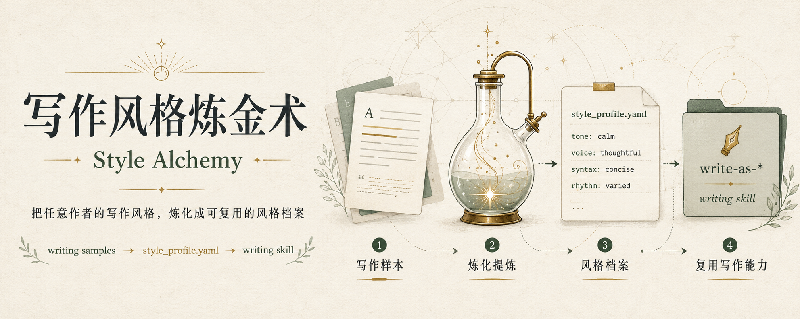

**English** | [中文](README.md)

<p align="center">
  
</p>

# Style Alchemy


> **Style Alchemy is a [Claude Code](https://claude.com/claude-code) skill** — it distills a batch of writing samples into a reusable style profile, then forges a dedicated Claude skill that writes in the same voice.

Not just a prompt — a **hand-editable, portable, verifiable** structured asset.

Works on any long-form text: blog posts, newsletters, academic papers, essays, Twitter/X threads, Substack pieces, Chinese platforms (公众号, 知乎, 小红书), or anything else you've collected.

### Input / Output

```
Input:  5-15+ writing samples (.md / .txt / .html)

Output:
  1. <author>-style-report.md   Deep human-readable report
                                (title craft, verbs, rhythm, tone palette…)
  2. style_profile.yaml         Machine-readable structured profile
  3. write-as-<id> Claude skill One-click writing assistant (optional)
```

---

## What is this

"Style" is fuzzy — you can feel that an author's writing "clicks," but you can't directly reuse the feeling. This skill does three things:

1. **Decompose** — Break "style" into 5 universal dimensions (titles / openings / rhythm / language / endings) plus scene-specific dimensions (blog / academic / social / etc.), with every claim backed by an excerpt from the actual samples.
2. **Crystallize** — Compress the analysis into a `style_profile.yaml` — machine-readable, hand-editable, composable.
3. **Forge** — Turn that profile into a standalone `write-as-<id>` skill. Next time you need to write in that voice, you have a tool ready.

---

## When to use this

- **Writers** — Study the writing patterns in public texts and build your own toolbox
- **Content teams** — Codify a publication's house style; onboard new writers via a tangible skill rather than a stale PDF guide
- **Legal / academic writing** — Lock in the conventions of a specific document type (case briefs, abstracts, opinions) as a writing assistant
- **Brand teams** — Compile your brand voice and tone guidelines into an executable skill, not a doc no one reads
- **AI / agent developers** — Treat "writing style" as a portable asset — one yaml travels everywhere
- **Stylistic research** — Profile the same author across different platforms and compare how voice adapts to context

> ⚠️ **Boundaries of use**: This tool is for analyzing writing patterns in public texts to assist creation and research. If the generated content is used commercially, published publicly, or could plausibly be confused with the work of a living person or specific brand, please evaluate the legal implications yourself (rights of publicity, trademark, unfair competition, etc.). A similarity check feature is on the roadmap to help with de-duplication.

---

## Quick Start

### 1. Install

Clone into your Claude Code skills directory:

```bash
# Linux / macOS
cd ~/.claude/skills
git clone https://github.com/snowmays/style-alchemy.git

# Windows (PowerShell)
cd $env:USERPROFILE\.claude\skills
git clone https://github.com/snowmays/style-alchemy.git
```

> Or download the zip and unpack into `~/.claude/skills/style-alchemy/`.

### 2. Prepare samples

Drop the target author's articles into any folder. Supported formats: `.md` / `.txt` / `.html`.

```
my_workspace/
└── raw/
    ├── article1.md
    ├── article2.html
    ├── article3.txt
    └── ...
```

Sample size guide:

| Samples | What you can do |
|---------|-----------------|
| 5-9 | 🟡 Quick sketch (not enough to generate a writing skill) |
| 10-14 | 🟢 Standard analysis |
| 15+ | 🟢🟢 Deep analysis + generate writing skill |

### 3. Trigger the skill

Just talk to Claude Code naturally:

```
Analyze the writing patterns of the articles in ./raw, then generate
a writing skill that produces text in the same voice.
```

Claude will first confirm parameters (path, author, platform, deliverables), then run the 9-step workflow:

```
[0] Confirm scope  →  [1] Normalize  →  [2] Scene detection  →  [3] Sort & sample
                                                                      ↓
[8] Forge writing skill ← [7] Compare ← [6] Write report+yaml ← [5] Scene extras ← [4] Core 5
```

### 4. Collect the outputs

```
my_workspace/
├── raw/                               # Your original samples (untouched)
├── samples_normalized/                # Normalized samples with frontmatter
│   ├── 001-xxx.md
│   └── ...
├── PaulGraham-style-report.md         # Human-readable deep dive
└── style_profile.yaml                 # Machine-readable style profile

~/.claude/skills/
└── write-as-paulgraham/               # The forged skill (optional)
    ├── SKILL.md
    └── references/style_profile.yaml
```

From now on, saying "write an essay about X in this voice" (or `@write-as-paulgraham`) in any Claude Code conversation will trigger the new skill.

---

## How it works

### Pipeline

```
        Raw samples (md / txt / html)
                │
                ▼
        [1] Normalize  ──→  scripts/normalize_samples.py
                │           uniform frontmatter, preserves micro-paragraphs,
                │           strips noise
                ▼
        [2] Scene detection
                │  blog / academic / newsletter / Twitter / 公众号 / 知乎 / etc.
                ▼
        [3] Core 5 dimensions  ──┐
                │                │  titles / openings / rhythm / language / endings
        [4] Scene extras  ──────┤
                │                │  platform-specific rules
                ▼                ▼
              ┌───────────────────────┐
              │  Twin artifacts       │
              │  ├─ report.md (human) │
              │  └─ profile.yaml      │
              └────────┬──────────────┘
                       │ optional
                       ▼
              [5] Forge write-as-<id> skill
```

### Why a yaml middle layer?

`style_profile.yaml` is the soul of this skill. Every quantifiable style signal — title formulas, power verbs, tone palette, signature phrases, rhythm patterns — lands in this yaml under a standard schema.

**Why this matters:**

- **Human-machine separation** — the report is for humans, the yaml is for machines, each does its job
- **Hand-editable** — analysis is never perfect; tweak a yaml field and regenerate the skill
- **Composable** — merge two yamls = blended style skill ("60% Paul Graham + 40% Tim Urban") (roadmap)
- **Measurable** — score new drafts against the profile to gauge "style match" (roadmap)

Full schema: [`references/style-profile-schema.md`](references/style-profile-schema.md).

### Core 5 + Scene extras

Different platforms look very different on the surface, but the underlying "language fabric" is shared. This skill separates them:

**Core 5 dimensions** (every article gets these):
- Title craft (info density, punctuation strategy, emotion vocab, reusable formulas)
- Opening craft (hook types, first-sentence length, pronoun habits)
- Rhythm (paragraph length distribution, micro-paragraphs, image cadence)
- **Language style** (20+ power verbs, tone palette, punctuation as narrative, signature phrases, custom vocabulary)
- Ending craft (type distribution, fixed CTAs)

**Scene extras** (activated based on detected platform):

| Scene | Extra dimensions |
|-------|------------------|
| Blog (serious) | argument structure, citation style, paragraph length |
| Academic | citation format, hedging density, term density, section template |
| Newsletter / Substack | section markers, opener / sign-off conventions |
| Twitter / X | thread strategy, sentences per tweet, quote-tweet usage |
| Personal essay | imagery density, sensory word distribution, time handling |
| 公众号 (WeChat) | header/footer, community naming, fixed sections, CTA placement |
| 知乎 (Zhihu) | answer opening strategy, credential display, debate posture |
| 小红书 (RedNote) | emoji density, tag strategy, persona implant, micro-line breaks |

Details: [`references/analysis-framework.md`](references/analysis-framework.md).

---

## Sample output

### Excerpt from the analysis report

```markdown
## V. Language Style — Deep Dive

### 5.1 Verb Selection

| Neutral form | Author's preferred replacement | Intensity | Polarity |
|--------------|--------------------------------|-----------|----------|
| says         | argues / claims / insists      | 4         | neutral  |
| good         | great / striking / remarkable  | 4         | positive |
| failed       | flopped / cratered             | 5         | negative |

> Excerpt: "He doesn't say it — he _insists_ on it." — "insists" replaces
> the neutral "says" to charge the same fact with stance.
```

### Excerpt from the style profile

```yaml
schema_version: "1.0"
profile_id: paulgraham
display_name: Paul Graham
sample_count: 15
sample_platforms: [blog]

portrait: |
  Paul Graham writes essays as causal arguments. Sentences are short to
  medium; vocabulary is everyday but precise. Paragraphs flow like
  conversation — claim, qualification, evidence, restatement. Openings
  state a thesis directly. Endings often loop back to the opening claim
  with new weight.

title_craft:
  avg_length: 3            # words
  info_density: low
  formulas:
    - id: f1
      pattern: "[single-noun concept]"
      example: "Hackers and Painters"
      when_to_use: essay collections
    - id: f2
      pattern: "[verb-ing] [noun]"
      example: "Beating the Averages"
      when_to_use: argumentative essays

language_style:
  power_verbs:
    - { verb: insist, replaces: say, intensity: 4, polarity: neutral }
    - { verb: cratered, replaces: failed, intensity: 5, polarity: negative }
  signature_phrases:
    - { phrase: "It turns out",      context: introducing a finding }
    - { phrase: "The trick is",      context: practical advice }

# ... full schema in references/style-profile-schema.md
```

---

## Project structure

```
style-alchemy/
├── SKILL.md                          # Skill entry point (Claude reads this)
├── scripts/
│   └── normalize_samples.py          # Normalize md/txt/html → uniform md
├── references/
│   ├── sample-format.md              # Normalized sample format spec
│   ├── analysis-framework.md         # Core 5 + scene extras methodology
│   ├── style-profile-schema.md       # YAML style profile schema
│   └── writing-skill-template.md     # Template for forging writing skills
├── README.md                         # Chinese (default)
├── README.en.md                      # You are here
└── LICENSE                           # MIT
```

---

## Roadmap

- [ ] **Similarity check** — compare generated output against the original samples to flag high-overlap phrasing (originality + compliance safeguard)
- [ ] **URL batch fetcher** — give a list of links, auto-build the sample set (blogs / newsletters / Substack first)
- [ ] **YAML schema linter** — validate ratios sum to ~1, required fields present, etc.
- [ ] **Style fusion** — merge multiple yamls into a hybrid writing skill ("60% style A + 40% style B")
- [ ] **docx / pdf normalization** — currently you have to convert these manually
- [ ] **Style-match scoring** — score a new draft against a profile to measure stylistic fidelity
- [ ] **More scene extras** — Reddit, B站, Medium, Twitter long-form, podcast transcripts

---

## Contributing

PRs and issues welcome. Especially appreciated:

- New scene-extra dimensions (if you've researched a vertical's writing conventions)
- More input formats for the normalizer
- Real-world style profile examples (sanitized) for the `examples/` folder

---

## License

[MIT](LICENSE) © snowmays

The style profiles and writing skills you produce are **yours**. This repo provides the tools — it claims no rights over what you create with them.
